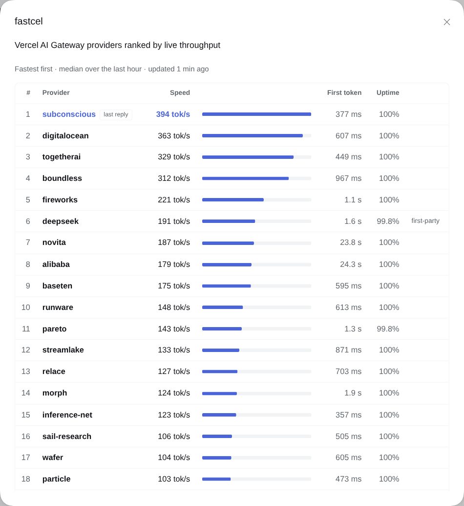

# dsh-fastcel

A [DeepSeek Harness](https://github.com/deepseek-ai/deepseek-harness) plugin that starts each Vercel AI Gateway conversation on the fastest provider for its model. It is the harness edition of [fastcel](https://github.com/DavidCarliez/fastcel), the Oh My Pi plugin.



Vercel AI Gateway serves many models through several providers, and their speeds differ a lot. `deepseek/deepseek-v4.1-flash-1017` has 22 providers. On one afternoon the fastest, subconscious, produced a median of 394 tokens per second over the last hour, and the slowest measured, runinfra, 42. Left to choose, the gateway sent three test requests to baseten (175 tok/s). With fastcel the same request went to subconscious.

## How it works

fastcel decides the order in which providers are tried. Vercel decides how long a conversation stays on the provider it landed on.

### fastcel ranks the providers

On every model call the harness sends to `ai-gateway.vercel.sh`, fastcel attaches the model's providers, fastest first:

1. It reads the provider stats from `GET /v1/models/{model}/endpoints`. This is public data, the same figures shown on the model's page at vercel.com/ai-gateway/models, and needs no key. The stats are cached per model for 15 minutes. Once they are stale, requests keep using them while a refresh runs in the background.
2. It orders the providers by median throughput over the last hour. A provider goes to the back of the list when it is deprecated, when fewer than 90% of its requests succeeded in the last 15 minutes, when the request has tools and the provider does not support them, or when its context window is smaller than the conversation.
3. It sends the list as `providerOptions.gateway.order`. If the first provider fails, the gateway falls back through the rest in speed order.

fastcel keeps no ranking between requests: each one carries the ranking as it stands at that moment. If the stats cannot be loaded, the request goes out unchanged and the gateway chooses as usual.

### Vercel keeps a conversation on one provider

The gateway does not simply take the first provider on the list. Its [session affinity](https://vercel.com/docs/ai-gateway/models-and-providers/session-affinity), on by default, remembers which provider answered a conversation's previous message and tries that provider first, so its prompt cache stays warm. In a session this plays out as follows:

1. **First message.** No provider is remembered yet, so the message goes to the top of fastcel's list.
2. **Following messages.** They stay on that provider, even if fastcel's ranking changes in the meantime.
3. **After a pause or a failure.** Vercel forgets the provider once the conversation has been idle longer than that provider's cache lifetime: about 5 minutes for most providers, 10 for OpenAI and Azure, and 1 hour for DeepSeek's own API. It also forgets it when the provider fails a request. The next message goes to whichever provider is fastest at that point, and the conversation stays there.

A new session or a subagent counts as a new conversation, so it starts on whichever provider is fastest when it begins.

### How it hooks into the harness

The harness's pi-ai adapter builds the gateway request itself and offers no hook to change its body, so fastcel works at two layers:

- An `llm/stream` listener wraps every model call in a request scope that knows the session and how many tokens its conversation held after the previous call.
- A hook on the process's `fetch` changes a request only when it comes from such a scope, is a `POST` to an inference endpoint of `https://ai-gateway.vercel.sh` (`/v1/messages`, `/v1/chat/completions` or `/v1/responses`), and its JSON body names a model. It adds the order, sends the request, and reads the gateway's routing record from the reply as it streams by, unchanged.

Every other request in the process is forwarded untouched. Stopping the plugin removes the hook.

### Details

- **Routing already in the request wins.** A request whose body already carries `providerOptions.gateway.order` or `.only` is sent as it is.
- **Some providers are skipped for your account.** Vercel marks some providers `plan_not_eligible` for some models. The gateway then moves on to the next provider in the list without trying the skipped one.
- **Why not `sort: "tps"`.** The gateway can sort providers by throughput itself, but when fastcel was tested most providers had no value in that sort, so faster providers came after slower ones; see [fastcel's notes](https://github.com/DavidCarliez/fastcel#details). fastcel ranks with the endpoint stats instead.

## Install

**Requires:** DeepSeek Harness **0.2.1-rc.2** (tested, web profile), Node.js **22+**, and a `vercel-ai-gateway` route on the harness's pi-ai adapter, for example in your profile's `cordis.patch.yml`:

```yaml
- id: llm-pi-ai
  name: "@deepseek-ai/dsh-llm-pi-ai"
  config:
    providers:
      vercel-ai-gateway:
        apiKeyEnv: VERCEL_AI_GATEWAY_API_KEY
        models:
          - id: deepseek/deepseek-v4.1-flash-1017
          - id: openai/gpt-oss-120b
```

Any pi-ai route whose endpoint is `https://ai-gateway.vercel.sh` works; fastcel recognizes the gateway by the host each request goes to, not by the route's name.

From this repository, run:

```sh
npm ci
npm run build
dsh plugin --profile web add "link:$PWD"
```

Then restart the harness. Install, restart or remove the plugin only when no reply is being generated. To remove it, run `dsh plugin --profile web remove dsh-fastcel` and restart.

## Use

Pick any Vercel AI Gateway model. fastcel shows the top of its current ranking, the provider and its speed, with a ⚡ in front:

```
⚡ subconscious · 394 tok/s
```

It sits below the composer of a session, and in the options row above the composer on the New Session page. It is hidden when the selected model does not go through the gateway.

When the model's maker serves it from its own API, that provider has the maker's name, so the panel marks it first-party, and the pick reads `deepseek (first-party) · 191 tok/s`. That means DeepSeek's own API, not the DeepSeek model.

A conversation that started earlier can still be on another provider, as described above. The panel shows where the last reply actually went.

| Command            | Effect                                                                                                    |
| ------------------ | --------------------------------------------------------------------------------------------------------- |
| `/fastcel`         | Opens the panel for the session's model. Outside the web client it prints the same table as text.          |
| `/fastcel <model>` | Prints the ranking of any gateway model as a table, e.g. `/fastcel zai/glm-5.1`.                           |
| `/fastcel refresh` | Drops cached stats, fetches them again and prints the session model's ranking.                            |

Clicking the pick opens the same panel. It lists the model's providers, fastest first, with each provider's speed, time to first token and uptime over the last 15 minutes. A note marks the first-party provider and says why a provider was moved down the list. Under the table, a line says which provider served the session's last reply and what Vercel's session affinity did. While the panel is open it follows replies as they finish. On a phone, the time to first token and uptime columns give way.

The served-by line comes from the routing record the gateway puts at the end of each reply, so it needs no extra request and no key. fastcel keeps it in memory for the most recent sessions; restarting the harness clears it.

## Develop

```sh
npm ci
npm test
npm run build
npm run check:package
```

The tests boot the real LLM runtime and pi-ai adapter over a fake network, so they check the request the Anthropic SDK actually sends, with no cloud calls. `check:package` packs the plugin from a clean checkout and loads its host and client entry points. CI runs all three on Node.js 22 and 24.

`src/ranking.js` orders providers, `src/stats.js` fetches and caches the endpoint stats, `src/router.js` and `src/gateway.js` change the gateway request and read its routing record, `src/fastcel.js` keeps the per-session state and builds reports, `src/server.js` wires them into the harness, and `src/client.jsx` draws the pick and the panel.

Rebuild after source edits. Client changes reach an open page on reload; host changes need a harness restart.

## License

[MIT](LICENSE)
